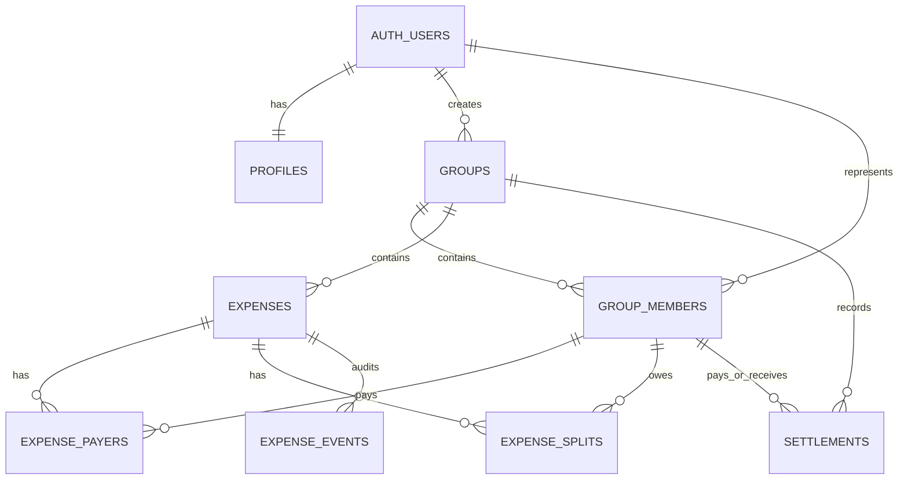

# Database design

## Scope

The initial schema in `supabase/migrations/20260727000000_core_database_foundation.sql` supports the planned Version 0.1 shared-expense workflow without adding UI or payment features. It models durable membership, draft and posted expenses, settlements that record external payments, and append-only expense audit events.

## Tables

| Table | Purpose | Important fields |
| --- | --- | --- |
| `profiles` | Minimal application profile linked one-to-one with `auth.users`. | `id`, `display_name`, `onboarding_completed_at`, timestamps. |
| `groups` | A shared-expense ledger with exactly one currency. | `name`, `currency_code`, `created_by`, `archived_at`. |
| `group_members` | Durable identity within a group for registered users and guests. | nullable `user_id`, display-name snapshot, role, `removed_at`. |
| `expenses` | A draft, posted, or voided shared expense. | `total_amount_minor`, `occurred_at`, status, creator, `voided_at`. |
| `expense_payers` | Amount each member paid toward an expense. | expense, group, member, `amount_minor`. |
| `expense_splits` | Amount each member owes for an expense. | expense, group, member, `amount_minor`. |
| `settlements` | A record that users say an external payment occurred. | payer, receiver, amount, settlement time, `voided_at`. |
| `expense_events` | Append-only audit events generated by database triggers. | event type, actor, subject, JSONB before/after snapshots. |

Composite foreign keys on the payer, split, and settlement tables ensure that referenced members belong to the same group as the parent record. Group-member IDs are never reused, so existing financial history continues to point at the same durable participant after a guest links to an account, is removed, or has their account deleted.

## Profile onboarding

The profile trigger continues to create a minimal private record with the fallback name `Member`, but that value does not mean onboarding is complete. `profiles.onboarding_completed_at` is null until the user explicitly completes setup. The authenticated client invokes `public.complete_profile(text)` rather than directly updating the table. The function trims the supplied name, rejects blank or whitespace-only input, enforces the 80-character profile limit, updates only `auth.uid()`'s profile, and records the completion timestamp in the same statement. This keeps the onboarding boundary explicit and atomic.

## Group creation and guests

An authenticated user with completed profile onboarding creates a group through the existing `groups` insert path. The `app_private.prepare_group_creation()` trigger requires `auth.uid()`, assigns that UUID as `created_by`, trims and validates the 120-character name, validates the uppercase three-letter currency code, and disallows creating an already archived group. The existing after-insert trigger then creates exactly one active owner membership with the user's profile display name, in the same transaction.

Clients no longer have direct insert access to `group_members`. `public.add_guest_member(uuid, text)` is the narrow ordinary-client operation for this feature: it accepts only a group ID and display name, requires an active owner or administrator, refuses archived groups, trims and validates the 80-character name, and always inserts a null `user_id` with the ordinary `member` role. Once a group is archived, its group and membership transition triggers reject subsequent writes. Registered-member invitations, guest claiming, removal, and role-management interfaces remain separate future operations.

## Money and currency

All money is stored as `bigint` minor units. For example, USD 10.00 is `1000` and USD 10.25 is `1025`. No floating-point money columns are used. Each group stores one uppercase ISO 4217 currency code; cross-currency calculations and conversion are intentionally out of scope.

## Expense lifecycle and financial invariants

An expense is created as a `draft`. Its authorised creator or a group administrator can add, change, or remove payer and split rows while it remains a draft. The `public.finalize_expense(uuid)` transaction function locks the draft and its child rows, verifies that payer totals and split totals each equal `total_amount_minor`, and only then changes the status to `posted`.

The posted-status trigger repeats the total checks at the database boundary. Payers and splits cannot change after posting, so a posted expense cannot become financially inconsistent through ordinary client writes. `public.void_expense(uuid)` preserves a posted expense and its audit history while removing it from future balance calculations. A draft can be voided when it should not be finalized.

Exact, percentage, and share-based split interfaces can be added later by calculating the final minor-unit split rows before finalization. The persisted source of truth remains the exact amount owed by each member.

## Membership, roles, and ownership

Every group is created with an owner membership automatically. Direct client membership inserts can only create active `member` records. Only a group owner can use the guarded role function to make an active, registered member (`user_id is not null`) an administrator; a guest may remain a member but can never be promoted to administrator. Ownership changes use `public.transfer_group_ownership(uuid, uuid)`, which accepts only a different active, registered member of the same group, assigns that successor first, and then demotes the current owner. The final active owner cannot be removed or demoted without a replacement.

Guests have a null `user_id` and no database credentials. Linking a guest to an account is a future controlled operation; it must retain the same `group_members.id` to preserve history. Before deleting an owner account, ownership must be transferred to an active registered member. An owner record remains historically valid if its linked account is deleted, but that group should receive human support review if no active registered owner remains.

## Historical preservation

The schema favours archives, removals, and voids over hard deletion. Groups can be archived, memberships can be removed, expenses and settlements can be voided, and group-member or actor references become null if an auth account is deleted. Expense and audit data is not cascaded away.

`expense_events` captures the expense, payer, and split row states relevant to a change. These JSONB snapshots deliberately contain operational identifiers, descriptions, amounts, timestamps, and statuses, but not authentication secrets, tokens, passwords, or raw authentication metadata.

## Indexes

Indexes support the primary access paths: active group lookup by user, active membership lookup by group, expense lists by group and date, payer and split lookup by group member, settlement lists by group and date, and chronological expense events. Composite uniqueness also supports the group-consistency foreign keys. No speculative analytics indexes are included.

## Known limitations

- The schema does not calculate balances; that future business logic must derive balances from posted expenses and non-voided settlements.
- The foundation contains no invitation or guest-claim workflow yet.
- Account-deletion and ownership-transfer operations need an operational support process before user account deletion is exposed.
- Receipt data, payments, bank connections, multiple currencies, and offline synchronisation are intentionally excluded.
